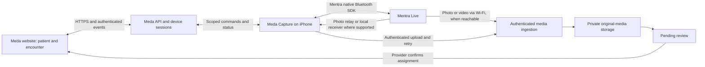

# Mentra Live integration — iPhone and Meda

Research date: October 30, 2026 (America/Phoenix).

User target: an existing iPhone and Mentra Live glasses, with a Meda-branded phone app that connects to the same clinical workspace as the website.

**Recommendation:** keep the website and build a small standalone **Meda Capture** iOS companion using Mentra's native Swift Bluetooth SDK. Prove still-photo capture and correct encounter assignment on the user's hardware first. Add short video, background recovery, encrypted offline transfer, and optional live preview in separate steps.

This is a researched design, not an implemented or hardware-validated integration. No pairing, camera quality, iPhone background capture, vendor agreement, or clinical suitability has been verified on the user's devices.

## 1. What is supported

Mentra's first-party Bluetooth SDK supports direct native iOS/Android and React Native app integration. The phone app owns the glasses connection; it does not have to be a miniapp inside the Mentra app. Mentra provides SwiftUI and Kotlin/React Native starter examples and photo captures from physical devices [1]. The SDK and repository use Apache-2.0 licensing; review the complete dependency notices, branding/trademark conditions, and distribution obligations separately.

The published npm `latest` checked during this review is `@mentra/bluetooth-sdk@3.2.1`, published October 5, 2026 [2]. The corresponding Starter Kit main commit pins `3.2.1`. Current MentraOS main documentation is ahead of that release: its docs variables identify `3.4.0`, and npm has separate beta/dev channels. Pin a completed coordinated release and its matching glasses software; do not mix snippets from main with arbitrary SDK/firmware versions. The published 3.2.1 tarball was inspected after verifying its npm SHA-512 integrity value.

The old `@mentra/sdk` cloud-server tutorials are a different generation. Current upstream docs describe on-phone `@mentra/miniapp` apps and explicitly label that SDK beta, recommending the Bluetooth SDK for Mentra Live [3].

| Capability | Evidence and implication for Meda |
| --- | --- |
| Scan, explicit pairing, reconnect, device status | Documented native SDK. Device choice must remain explicit when several providers have glasses. |
| Still-photo capture | `requestPhoto` supports capture settings, request IDs and upload URL/token. Capture and webhook delivery are asynchronous. |
| Recorded video | `startVideoRecording` and `stopVideoRecording` are documented. Upload credentials can be supplied at stop time. Limit clip duration and validate actual file sizes. |
| Button events, battery and microphone | Supported surfaces, conditional on model, permissions and software. Enable only capabilities observed on the paired device. |
| Live streaming | RTMP, SRT, and WHIP/WebRTC ingest are documented. Browser playback needs a suitable media gateway/player; raw RTMP is not browser video. |
| Image/text display in the lens | Mentra Live has no display. Show patient/encounter identity on the phone or desktop; use appropriate audio/status cues without promising a visual HUD. |
| Phone-free Meda clinical app | Not established by the reviewed supported app model. Hardware gallery recording is distinct from a complete authenticated chart application. Our chosen standalone app is an iPhone app. |
| Ordinary browser or PWA control | Not the SDK's documented native integration surface. An installed PWA or web wrapper alone does not provide the native Bluetooth SDK. |
| Desktop native app | Mac examples exist, but source/release documentation differs about availability. Verify exact artifacts before committing to native Mac support; no Windows direct-connect support was established. The website plus iPhone bridge avoids this dependency. |

## 2. Proposed architecture

This is one Meda backend, shared by the website and phone app. The phone needs a focused clinical capture UI, not a duplicate independent patient database. Suggested screens: sign-in, device/pairing status, patient/encounter selection, capture, review, and upload/recovery queue.

For the first prototype, keep the phone and glasses foregrounded and use synthetic images. A local trusted development setup can test pairing and media transfer before an AWS account is established. A provider-facing deployment later needs a reachable HTTPS API; the existing AWS demo runbook remains undeployed.

Two media paths should be evaluated deliberately:

- **Phone-managed ingest:** receive media on the phone when supported, then upload through Meda. This gives Meda more control over encrypted retry storage, checksums and authentication, but iOS background and local-network limits require testing.
- **Direct glasses upload:** supply our HTTPS webhook and a short-lived scoped bearer token. This reduces phone relaying, but requires the glasses to reach the endpoint and careful retry/expiry handling. Do not assume photo Bluetooth fallback implies equivalent reliable video fallback.

Do not claim all media stays away from third parties solely because the upload URL is ours. Verify DNS/HTTP traffic, diagnostics, OTA, telemetry, local caches and firmware behavior on the selected release.

## 3. The provider workflow

1. Provider signs into Meda on the website and/or phone. Pair the authorized phone and chosen glasses with the correct clinic/user.
2. Select the patient, encounter, optional procedure, anatomical site and pre/intra/post phase. Document the required institutional consent when this is implemented for a clinical pilot.
3. The backend creates an expiring capture session bound to clinic, provider, device and encounter. The phone acknowledges its active session before capture is enabled. Avoid names or MRNs in device logs, capture IDs, URLs or telemetry.
4. Provider presses an in-app capture control or configured glasses button. Choose one owner of button capture so a firmware gallery action and a Meda button handler do not both create a photo.
5. Capture events keep their original session association even if the desktop navigates to another patient. Do not silently retarget an in-flight recording. A capture without a valid session stays unassigned/quarantined rather than attaching to the last patient.
6. Media is transferred to authenticated ingestion, validated, checked for duplicate request IDs/checksums, and placed in `pending_review`. The UI distinguishes requested, captured, transferring, received and chart-committed states.
7. Provider reviews the image/clip and its patient/encounter assignment. Only explicit successful chart commit puts it in the patient gallery. Reassignment/corrections follow an audited policy.
8. The website receives a patient-scoped event and refreshes the gallery. This does not require the desktop browser to pair directly with the glasses.

## 4. Required changes to the existing Meda app

The current app has real accounts, patient/encounter/procedure records, reviewed media and original/derivative linkage. Its Device screen truthfully says integration pending. It does **not** implement the device/session/ingest endpoints described as a future contract in `MENTRA_DEVELOPER_CONTRACT.md`.

| Area | Needed work |
| --- | --- |
| Native identity | Authenticate the iPhone to the same Meda account/clinic. Add appropriate native authorization and revocation, preferably managed OIDC with PKCE for the future clinical app. Existing browser cookie/CSRF auth is not a glasses upload token. |
| Device adapter | Implement a real adapter around the SDK with explicit capability/status updates, connection ownership, request correlation and error handling. |
| Capture sessions/jobs | Persist command/session state and expiry; scope every operation to the provider and clinic; reconcile after app/server restarts. |
| Hardware upload ingress | Add a separate authenticated adapter for Mentra multipart payloads. Still photos use `photo` plus `requestId`; video uses `video` (some example paths also accept `file`). Our browser endpoint expects `file` and browser cookie/Origin/CSRF checks. It is not directly plug-compatible. |
| Upload authorization | Issue narrowly scoped short-lived tokens, validate expected capture/session and size/type/checksum, and prevent replay/duplicate attachment. Do not relax browser CSRF or make upload anonymous. |
| Object storage | For the clinical architecture, move to private encrypted object storage and processing/scanning; the current local-disk/SQLite demo is not that architecture. A multipart webhook POST is not automatically compatible with a presigned S3 PUT URL. |
| Browser updates | Authenticated, clinic/provider-scoped SSE or WebSocket events for device and media state; polling is acceptable for the first proof. |
| Large video | Current limit is 25 MB/file. Short clips first; design resumable/object-storage ingest before supporting longer recordings. |
| Consent and audit | Clinical consent and comprehensive record-access audit remain prerequisites before real patient capture. A synthetic-data acknowledgement is not consent. |
| Original preservation | Store exactly what was delivered with provenance and effective capture/transfer settings. BLE fallback can compress media, so do not silently call it a full-resolution sensor original. |

The existing developer contract is a useful foundation, but it is a specification, not evidence that its backend, adapter or security gates are already complete.

## 5. iPhone implementation choice

**SwiftUI + `MentraBluetoothSDK` is the preferred first implementation for the current iPhone-only requirement.** It follows the native example, gives direct access to Core Bluetooth lifecycle, background behavior, Keychain and protected file storage, and avoids a separate cross-platform runtime for a small capture companion.

React Native/Expo with `@mentra/bluetooth-sdk` is reasonable if Android is an immediate requirement. It can reuse TypeScript contracts and some application logic, but the current Vite/React-DOM/CSS interface does not automatically become a native app. Expo Go cannot load the native SDK; a development or signed native build is needed [4].

A thin native WebView host is also possible, but still requires a real native SDK bridge. Keep any bridge narrowly scoped; never give arbitrary remote web content unrestricted hardware/credential access. Do not copy the entire website into a WebView and assume pairing, offline storage, permissions and background capture are solved.

The iOS SDK docs require `bluetooth-central` background mode for background reconnection. This is not a guarantee of uninterrupted execution: test locked-phone behavior, iOS suspension, app termination, reconnect and long transfers. Current upstream docs explicitly warn that terminated-app Core Bluetooth state restoration is not enabled [5]. Do not add continuous background microphone permissions merely to keep the app alive.

For private iPhone evaluation, use signed developer builds/TestFlight. A developer needs access to an appropriate Mac/Xcode or macOS build service, plus Apple signing/distribution setup. An ordinary website link cannot install a production iOS application by itself.

## 6. Dermatology feasibility is a separate gate

The camera API establishes technical capture capability, not diagnostic fitness. Before optimizing software around this hardware, test:

- Sharpness and minimum useful working distance on fine skin-like texture and a calibrated test target.
- Color and exposure consistency under clinic lighting and glare.
- Head-motion blur, wide-angle distortion, framing/parallax and whether the capture covers the intended site.
- Full-resolution versus transferred/fallback-compressed output, including pixel dimensions and compression artifacts.
- Short procedure videos, low battery, heat and realistic duty cycle.

Start with procedure/workflow documentation and general site images. Do not position the glasses as a dermatoscope or validated lesion-comparison camera. Standardized close-up/dermoscopic imaging may still require a dedicated camera, phone attachment or dermatoscope. Save any derived crops/annotations as versions and avoid adding invented automated lesion measurements.

Mentra Live has no display, so clinicians cannot rely on a floating patient chart or in-lens aiming reticle. A phone preview or authenticated desktop preview may assist framing, but exact preview support and latency must be validated independently. Native streaming and the miniapp's `stream.preview` are different APIs; upstream miniapp docs limit that preview to meeting video and explicitly reject a general glasses preview [6].

## 7. Privacy and operational constraints

The published native SDK documentation states that usage analytics are enabled by default and explains how to disable them before SDK startup. They include SDK/device/install metadata and hardware serial; the documentation says those analytics do not include photo/microphone contents. For clinical evaluation, disable unnecessary SDK analytics, prevent PHI in logs, and verify actual egress. Newer upstream docs describe a separate startup update check even when analytics are off, so account for release/update traffic too [7].

Prefer no automatic saving to the consumer photo library, bounded encrypted phone queues protected with OS storage/Keychain, explicit retention, and device/session revocation. `save:false` or disabling a gallery feature is not proof that firmware caches or flash remnants are absent; confirm glasses storage, deletion, encryption and lost-device behavior with Mentra.

Audio should be off by default in the initial workflow unless required and authorized. Leave recording privacy indicators enabled. Consent must cover the actual modalities and institutional context. Verify Mentra's vendor/data-processing/BAA position and any subprocessors before sending PHI; open-source licensing and AWS hosting do not settle those questions.

Clinic Wi-Fi is part of the feasibility test: endpoint reachability, client isolation, enterprise authentication, guest networks and internet restrictions can alter which transfer paths work. Do not bypass certificate validation or expose a local unauthenticated demo receiver for clinical use.

## 8. Suggested delivery sequence and acceptance

1. **Hardware/quality proof:** use Mentra's matching native iOS sample with the user's iPhone and Live glasses. Pair, reconnect, take stills, record a short clip and receive files on a trusted local test setup. Use no patients. Record exact SDK/firmware versions, transfer method and measured quality/latency. Stop or narrow the use case if images are unsuitable.
2. **Meda Capture alpha:** build Meda-branded sign-in/pairing/context/capture/review screens; add scoped ingestion and context validation. Demonstrate one fictional patient → encounter → photo → review → gallery, including website-initiated capture if that is needed.
3. **Reliability and video:** add encrypted retry/recovery, bounded recordings, explicit lost-connection states and fresh stop-time upload tokens. Prove reconnect, interrupted transfers and duplicate-event handling. Validate phone locked, app backgrounded and app terminated separately.
4. **Provider/clinical preparation:** deploy the agreed AWS architecture, complete vendor and institutional gates, test backups and wrong-patient safeguards, and conduct a controlled usability evaluation. Live streaming, transcription and wider platforms are optional later scopes.

Required tests include: changing patients while a recording is active; button capture without a session; token/session expiry during a recording; device/phone disconnect; killed app; wrong device; failed upload/retry without duplication; gallery changes after review only; another account/clinic denied access; and the original file retained unchanged after edits.

Do not promise a fixed schedule or clinical pilot readiness before the hardware, optical quality and release compatibility proof. No current result is a successful test on the user's glasses.

## Sources and evidence limits

The documentation website was blocked by this cloud environment's network policy. The research instead used first-party GitHub source/documentation, the public Starter Kit and published npm artifact metadata/source. No physical device was accessible and no SDK was executed against hardware.

1. [Mentra Bluetooth SDK Starter Kit](https://github.com/Mentra-Community/Mentra-Bluetooth-SDK-Starter-Kit/tree/0f6aaa783c2530f9abea5c2edf3e2b110efd482c), especially [API reference](https://github.com/Mentra-Community/Mentra-Bluetooth-SDK-Starter-Kit/blob/0f6aaa783c2530f9abea5c2edf3e2b110efd482c/docs/api-reference.md) and [hardware notes](https://github.com/Mentra-Community/Mentra-Bluetooth-SDK-Starter-Kit/blob/0f6aaa783c2530f9abea5c2edf3e2b110efd482c/docs/hardware-integration.md).
2. [Published Bluetooth SDK 3.2.1 metadata](https://registry.npmjs.org/@mentra%2fbluetooth-sdk/3.2.1). npm `latest`, beta and dev tags were checked separately. The published tarball's integrity was verified before source inspection.
3. [Current miniapp overview](https://github.com/Mentra-Community/MentraOS/blob/0e7309f21cd0c9cb96264b8e7266b4c98d7dbeb4/mintlify-docs/app-devs/getting-started/overview.mdx) and [beta/Live recommendation](https://github.com/Mentra-Community/MentraOS/blob/0e7309f21cd0c9cb96264b8e7266b4c98d7dbeb4/mintlify-docs/snippets/beta-note.mdx).
4. [Native Bluetooth SDK overview](https://github.com/Mentra-Community/MentraOS/blob/0e7309f21cd0c9cb96264b8e7266b4c98d7dbeb4/mintlify-docs/bluetooth-sdk/overview.mdx) and [React Native/Expo requirements](https://github.com/Mentra-Community/MentraOS/blob/0e7309f21cd0c9cb96264b8e7266b4c98d7dbeb4/mintlify-docs/bluetooth-sdk/react-native-expo.mdx).
5. [iOS native/background guide](https://github.com/Mentra-Community/MentraOS/blob/0e7309f21cd0c9cb96264b8e7266b4c98d7dbeb4/mintlify-docs/bluetooth-sdk/ios.mdx).
6. [Native camera/streaming](https://github.com/Mentra-Community/MentraOS/blob/0e7309f21cd0c9cb96264b8e7266b4c98d7dbeb4/mintlify-docs/bluetooth-sdk/camera-streaming.mdx) versus [miniapp preview limitations](https://github.com/Mentra-Community/MentraOS/blob/0e7309f21cd0c9cb96264b8e7266b4c98d7dbeb4/mintlify-docs/app-devs/core-concepts/stream-preview.mdx).
7. [SDK analytics explanation](https://github.com/Mentra-Community/MentraOS/blob/0e7309f21cd0c9cb96264b8e7266b4c98d7dbeb4/mobile/modules/bluetooth-sdk/README.md) and [production/restricted-network checklist](https://github.com/Mentra-Community/MentraOS/blob/0e7309f21cd0c9cb96264b8e7266b4c98d7dbeb4/mintlify-docs/bluetooth-sdk/production-checklist.mdx). Newer upstream behavior must be checked against the pinned deployed release.
8. Meda implementation reviewed at commit `2ad9bcc18e2fb849375ecb724b36f2450f21c517`: `server/app.mjs`, `src/components/CaptureStudio.tsx`, `docs/IMPLEMENTED_API.md`, and `MENTRA_DEVELOPER_CONTRACT.md`.
